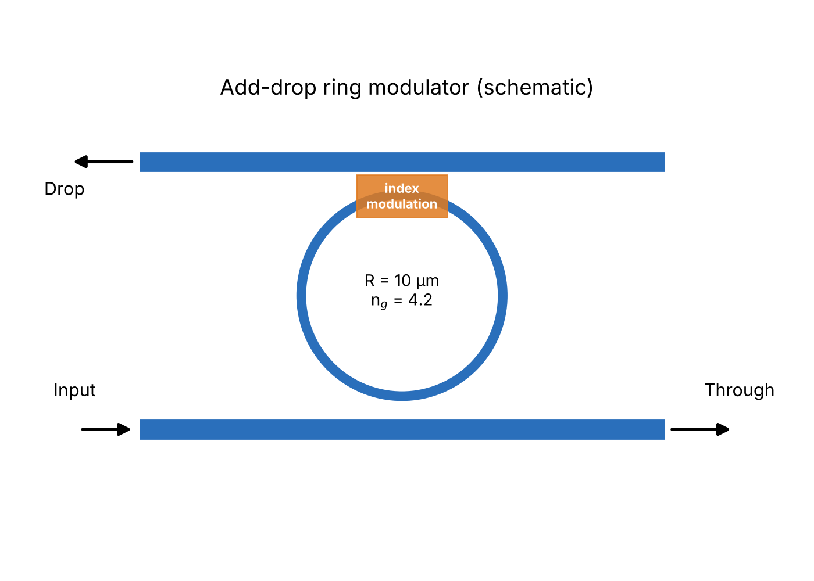
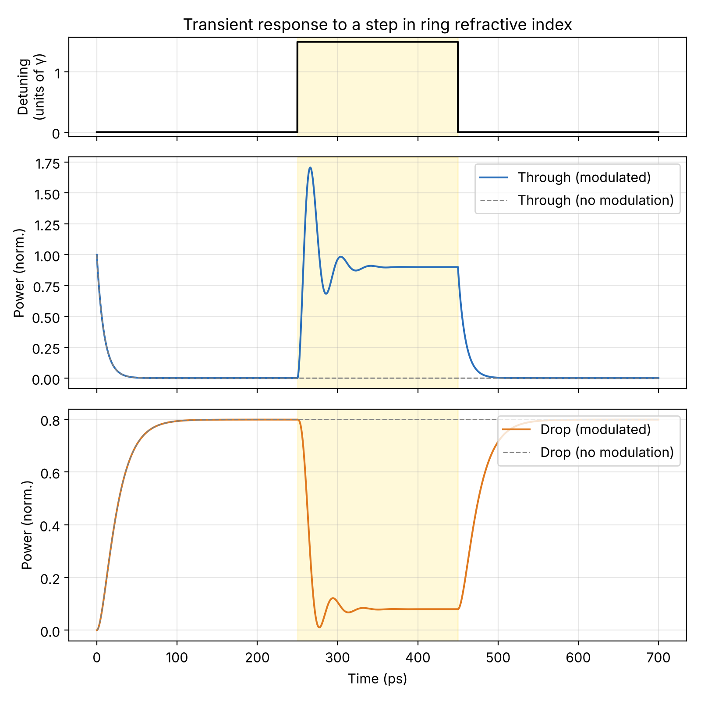
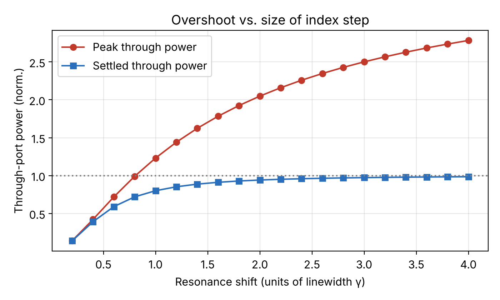

# Ring Modulator Transient Response with Ansys Lumerical

Simulation workflow for the transient behavior of a silicon add-drop ring modulator, built on **Ansys Lumerical MODE (2.5D varFDTD)** driven from Python through `lumapi`.

The ring's spectrum and its sensitivity to a refractive-index change are computed with the Lumerical solver. Those results are then turned into a time-domain model, so the response to an abrupt index step (overshoot, ringing, settling) can be predicted for the simulated device.



## Workflow

```
lumerical/ring_varfdtd.py        varFDTD: ring spectra for two ring indices  ->  data/spectra_*.npz
analysis/fit_and_transient.py    fit spectra -> coupled-mode parameters -> time-domain response  ->  images/
```

1. **varFDTD simulation (Lumerical MODE).** An SOI add-drop ring (220 nm Si, 500 nm wide, R = 4 µm, 200 nm gap) is built and simulated with a broadband mode source. Through- and drop-port spectra are recorded for the baseline ring index and for a ring index raised by `dn` (default 5×10⁻⁴), which is the static change an electrical drive would apply.
2. **Fit.** One resonance is fitted with the exact add-drop transfer function, giving the self-coupling coefficients, round-trip loss, optical path length, loaded Q and FSR.
3. **Shift.** The resonance wavelength shift between the two Lumerical runs gives the modulation sensitivity (nm per unit index) and the step size in linewidths.
4. **Transient.** The fitted parameters define a temporal coupled-mode-theory model, which is stepped in time with the measured resonance shift switched on and off.

## Run

Requirements: Ansys Lumerical (MODE) with the Python API, Python 3.8+, `numpy`, `scipy`, `matplotlib`.

```bash
pip install -r requirements.txt

cd lumerical
python ring_varfdtd.py --hide            # add --dn, --sim-time to change the index step / run time

cd ../analysis
python fit_and_transient.py              # figures -> ../images, numbers -> ../data/summary.json
```

If `lumapi` is not importable, set `LUMAPI_PATH` to Lumerical's `api/python` folder. `python fit_and_transient.py --selftest` checks the fitting code on synthetic data without Lumerical.

## Results

Generated into `images/` by `analysis/fit_and_transient.py`:





Key numbers (loaded Q, FSR, linewidth, resonance shift per index step, peak overshoot) are written to `data/summary.json`.

## Analytical cross-check

`reference_model/` holds a stand-alone Python coupled-mode model with illustrative parameters, used to sanity-check the time-domain part of the pipeline before connecting it to Lumerical data. For a step of 1.5 linewidths on a critically coupled ring it predicts a through-port overshoot of about 1.7× the input power, settling near 0.9.


## Limitations

- The transient is not simulated inside the FDTD solver: the index change is applied through two static varFDTD runs plus a coupled-mode time-domain model. Switching the index in time inside Lumerical itself requires a custom plugin material (compiled C++), which this repository does not include.
- The silicon core is a non-dispersive object-defined dielectric so that the ring index can be perturbed cleanly; the true group index of dispersive silicon is somewhat higher.
- Single resonance, single polarization, no free-carrier, thermal or RC dynamics.
- Lumerical property names can differ slightly between versions. The scripts report any property they could not set (`[warning] ...`) instead of failing silently; adjust those names to match your version's object properties.

## Acknowledgement

The study of a ring's response to a time-varying index was inspired by the Ansys Lumerical tutorial *"Ring modulator transient response (varFDTD)"*: https://optics.ansys.com/hc/en-us/articles/360042195693-Ring-modulator-transient-response-varFDTD

That tutorial switches the index inside the solver with a custom material plugin. The scripts, geometry, analysis, text and figures in this repository are my own.

## Author

Ripon Kumar Dey, PhD
